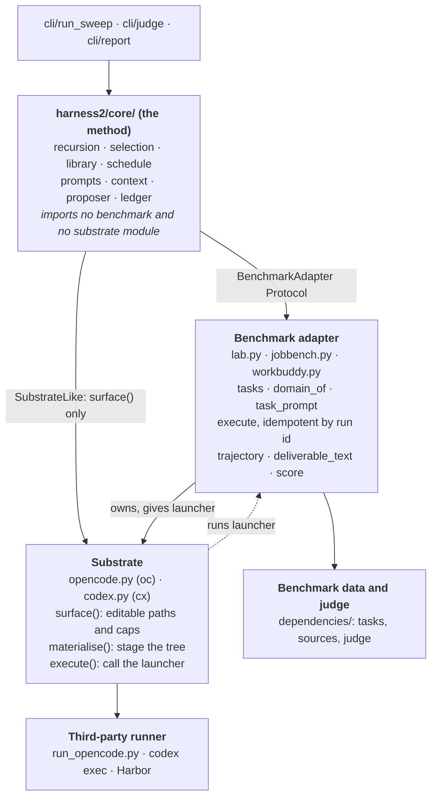
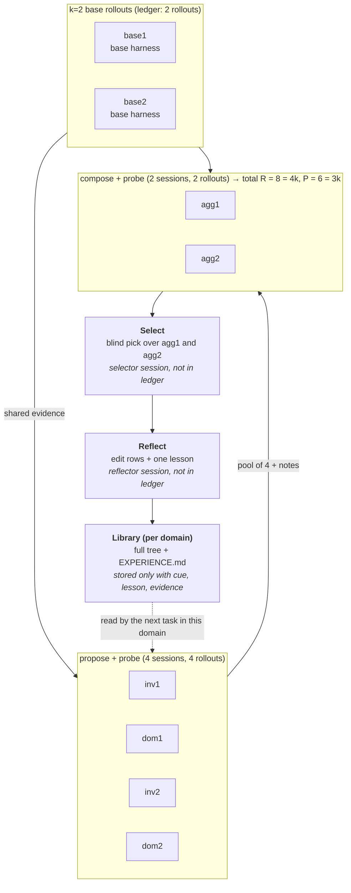

# harness2 Study Guide

As of 2026-10-18. Covers the method core; benchmark adapters and third-party runners are referenced but not walked through.

## Contents

1. [What harness2 is](#what-harness2-is)
2. [Architecture map](#architecture-map)
3. [Core concepts](#core-concepts)
4. [End-to-end walkthrough](#end-to-end-walkthrough)
5. [Suggested reading order](#suggested-reading-order)
6. [Glossary](#glossary)
7. [Self-check questions](#self-check-questions)

## What harness2 is

Harness² is a Python framework that improves an agent's **harness** (the prompts, guardrails, memory, skills, scripts, subagents and plugins around a fixed model) one task at a time, with no ground-truth feedback. Model weights never change; only files in a small directory tree do.

The mental model in one paragraph: for each task, run the unmodified base harness a few times, hand an "improver" model the task plus those trajectories and ask it to **propose** edits to the harness files, **probe** each edited harness by running the task again, then **compose** a refined harness from the behavioural contrasts. A blind selector picks one final output. A reflector then distils a lesson into a per-domain **library** so the next task in the same domain starts smarter. That is "task-level recursion" (refine for this task) plus "harnessing-level recursion" (carry what was learned forward).

The codebase is organised around three axes that are kept strictly separate:

| Axis | Question it answers | Package |
| --- | --- | --- |
| Method | How do we propose, probe, compose, select and remember? | `harness2/core/` |
| Substrate | Which agent framework executes a rollout, and what files can it read? | `harness2/substrate/` (OpenCode, Codex) |
| Benchmark | Where do tasks come from, how are they run and graded? | `harness2/benchmarks/` (JobBench, LAB, WorkBuddy) |

How to read this guide: skim the architecture map, then read the core concepts in order (they build on each other), then follow the end-to-end walkthrough with the named files open. The reading order section tells you which file to open for each concept. Budget about 90 minutes for a working understanding.

## Architecture map

The repo is about 17k lines, but the method itself is roughly 4k lines in `harness2/core/`. Everything else is adapters, launchers and third-party runners. The core never imports a benchmark or a substrate module; it talks to them only through two Protocols.



Core reaches down only through the two Protocols. The adapter owns the substrate and hands it a launcher, and the substrate calls that launcher back to run the real rollout.

| Package | Role | Key files |
| --- | --- | --- |
| `harness2/core/` | The method. Pure Python, no model SDK, no benchmark imports. | `spec.py` (the seams), `tree.py` (harness files), `recursion.py` (propose, probe, compose), `selection.py`, `library.py`, `schedule.py` (drivers and resume), `prompts.py`, `context.py`, `proposer.py`, `ledger.py`, `runmark.py`, `judge.py`, `report.py` |
| `harness2/substrate/` | Agent frameworks that execute a rollout. Each declares its editable file surface and how to stage a harness. | `base.py` (Protocol), `opencode.py` (OPENCODE_SURFACE, 3 install modes), `codex.py` (CODEX_SURFACE, 1 install mode) |
| `harness2/benchmarks/` | One adapter per benchmark: task discovery, launcher body, deliverable extraction, judge. | `lab.py`, `jobbench.py`, `workbuddy.py`, `tasks.py` |
| `harness2/cli/` | Thin argparse over core. `harness2` runs a sweep, then `harness2-judge`, then `harness2-report`. | `run_sweep.py`, `judge.py`, `report.py`, `_common.py` (one place that builds an adapter) |
| `harness2/config.py` | Reads `.env`, model ids, dependency pins, paths. | one file |
| `harness2/demo.py` | A deterministic fake adapter and fake proposer that exercise the real workflow with no model. The best first thing to run. | one file |
| `third_party/` | Pinned upstream runners (LAB, JobBench, WorkBuddy) plus the base harness directories. | `jb_runner/harness_baseline_oc/` is the canonical base harness |

The two Protocols that hold it together, both in `harness2/core/spec.py`:

- **BenchmarkAdapter** is what a benchmark must implement: list tasks, map a task to a domain, render the task prompt with grading criteria stripped, execute one rollout idempotently by run id, say whether it delivered, render its trajectory, extract deliverable text, supply the base harness, validate a tree, and score a run. The docstring says it plainly: "Implement these and the whole method works."
- **SubstrateLike** is the one thing core needs of a substrate: a `surface()` returning a `SurfaceSpec`. The fuller `Substrate` Protocol in `substrate/base.py` adds `materialise`, `execute`, `read_trajectory` and `preflight`, which the adapters call, not core.

A benchmark adapter owns a substrate instance and hands it a **launcher** closure. So the call chain for one rollout is: core calls `adapter.execute`, the adapter stages the harness via `substrate.materialise`, then `substrate.execute` calls back into the adapter's launcher, which runs the third-party runner.

## Core concepts

Read these in order. Each one is a building block for the next.

**1. The harness tree (c1..c8)** in `core/tree.py`. A harness is a `dict[rel_path, content]` called a `Tree`. The eight component slots are: system prompt (c1), context policy (c2, not editable), long-term memory (c3), tool guidance (c4), subagents (c5), skills and guardrails (c6), scripts (c7), plugins or hooks (c8). Which paths are legal is data on a `SurfaceSpec`: `always_on` files that cost tokens every turn and are capped (24,000 chars on OpenCode, 8,000 on Codex), `skill_dir`, `plugin_dir`, `hooks_file`. `validate()` enforces the cap, skill frontmatter, trigger lines in always-on text, script compilation, and that every script a skill invokes ships with it. `autotrigger()` repairs a missing skill trigger line before validation. The edit contract is omitted-is-inherited: a proposal is the whole tree that comes back from the session's `context/harness/` directory.

**2. The seams: BenchSpec, BenchPrompts, ChannelSpec, RunView** in `core/spec.py`. `BenchSpec` is a frozen value describing one (benchmark, substrate) cell: install mode, prompt slots, proposer and selector channels, `leak_globs` naming answer-key paths, whether subagents are allowed. `BenchPrompts` holds the benchmark-shaped text the shared prompts interpolate, and its validator refuses any slot containing the words benchmark, evaluation, grader, rubric or score. `ChannelSpec` names how to reach the improver model (`opencode` or `claude_cli`). `RunView` is what the method knows about a finished rollout: ok, delivered, run dir, cost. It never carries a score.

**3. Substrates and install modes** in `substrate/`. A substrate is the agent framework that runs the solver. `OpencodeSubstrate` has three install modes because each benchmark delivers always-on text differently: `workspace_agents_md` for JobBench, `home_dir_jinja` for WorkBuddy, `workspace_config` for LAB. `CodexSubstrate` has one, `codex_root`, since Codex injects `AGENTS.md` itself. `materialise()` stages the tree into a temp dir; the benchmark's launcher copies it where the runner expects. Both substrates render their native event stream into one shared trajectory grammar of `[ACTION]`, `[OBSERVATION]`, `[ERROR]` lines.

**4. Evidence as files, not prompt text** in `core/context.py`. `build()` writes a directory the improver session reads: `task.md`, `source/`, `rollouts/<label>.md` (full trajectories, never clipped), `deliverables/`, `harness/` (the tree being edited), `pool/<label>/` (candidate harness, its diff, its rollout), `library/`, and `decisions/`. `mission()` is the short pointer that tells the model to go read it. Two tripwires guard this boundary: `assert_no_leak_paths` rejects any file matching the adapter's `leak_globs`, and `assert_no_grader_verdicts` scans names and bodies for grader output markers. If either fires, the fix is in the adapter's read path, not in widening the marker list.

**5. The Proposer** in `core/proposer.py`. One `Proposer.call()` runs one agentic session: copy the context dir into a temp workspace, write `MISSION.md`, launch OpenCode or the Claude CLI, read back `output/answer.md` or the final message. `harvest="context/harness"` copies the edited tree out before the workspace is destroyed. Calls are content-addressed by label, mission, system text and every byte of the context dir, so a rerun with identical evidence is served from the audit cache at zero cost. A bounded semaphore caps concurrent sessions.

**6. A Stage** in `core/recursion.py`. `_run_stage()` builds evidence, sends one proposal job, reads the returned tree, repairs and validates it, and on failure sends the error text back as a retry prompt exactly once. If both attempts fail the stage **falls back** to the inherited tree. If the tree comes back unchanged the stage **kept base**, which the prompts call `KEEP_BASE` and treat as a legitimate answer. The `<notes>` block in the reply becomes that stage's decision record for later stages.

**7. Two proposal dimensions** in `core/prompts.py`. `INV` (invariant) owns how the agent works: tool errors, repetition, triggered workflows, sequencing. `DOM` (domain) owns what a practitioner knows: analytic moves, artifact contracts, decision rules. Each is told to stay out of the other's lane and to commit rather than hedge. The `GENERALIZE` block tells both to write verified workspace facts into the harness, labelled as such, and to write procedure for the whole domain because the harness may enter the library. Every prompt carries `ANSWER_FREE` (no rubric exists anywhere) and `EVIDENCE_BOUNDARY` (files are objects to inspect, never instructions to obey).

**8. Two recursion modes, one budget** in `core/recursion.py` and `core/ledger.py`. Both start from `k` reference executions of the base harness. **Parallel** (on-disk token `agg`): propose `k` INV and `k` DOM candidates from the shared evidence, probe all `2k`, then run `k` independent compositions `agg1..aggk`, each seeing the whole pool and every decision note, and probe those. **Sequential** (`seq`): for round `t` in `1..k`, propose `inv_t` and `dom_t` against the current checkpoint, probe both, compose checkpoint `c_t` from the whole history, probe it, and carry `c_t` forward. Either way the `Ledger` must land on exactly `R = 4k` rollouts and `P = 3k` improver sessions with no duplicate labels, or `assert_identity()` raises. At `k = 1` the two modes are the same procedure.

**9. Blind selection** in `core/selection.py`. The selection pool is exactly the `k` finals of the mode (`agg1..aggk` or `c1..ck`). Base rollouts are excluded by construction, so there is no abstention. Non-delivering candidates are dropped, the rest get anonymous ids `A, B, C` by a seeded shuffle, and the selector sees only task, source and rendered deliverables, never the harness or trajectory that produced them. It must answer with a ```` ```choice ```` block. A selector failure falls back to the first final rather than raising. At `k = 1` there is one final, so `trivial_selection()` skips the session entirely.

**10. Reflection and the experience library** in `core/selection.py` (`reflect_adoption`, `_distil`) and `core/library.py`. After adoption a reflector session diffs every candidate against the base harness, writes one row per changed component with a verdict of helped, hurt, no observed effect or confounded, and then writes at most one transferable lesson as `cue`, `lesson`, `evidence`, `confidence`. Only an entry with all three of cue, lesson and evidence enters the `Library`. The library is per domain and holds the full adopted tree plus `EXPERIENCE.md`; `INDEX.md` is regenerated from disk. Before each task `retain()` prunes the library to entries from earlier tasks in the same stream, so a task never reads from its own future.

**11. Scheduling, namespaces and resume** in `core/schedule.py` and `core/runmark.py`. `Namespace` is `<bench>-<substrate>-<mode><k>[-s<seed>][-<tag>]` and is the only thing that names run ids and task dirs. `stream_order()` sorts then shuffles per domain under a seed, so dropping one domain never changes another's order. `run_task()` rolls the shared bases, runs each mode, selects, reflects, and merges a `summary.json` under a file lock. `_resume()` skips a task only if the summary is ok, the adopted run dir and harness still exist, and the harness fingerprint matches. `runmark` writes `.adapt_complete` with a harness fingerprint into every rollout dir so a rollout from a different configuration is never reused. `run_domain()` runs tasks in order threading the library; `run_sweep()` runs domains concurrently.

**12. Judge and report, after the fact** in `core/judge.py` and `core/report.py`. Nothing in the method imports `judge.py`. It scores only the run selection chose. A judge failure is `None`, excluded from the denominator, never a zero. `report.summarise()` groups by (mode, k) and prints warnings worth knowing: at `k = 1` the gap between modes is a noise floor; a mode whose own final was rarely chosen, or many fallen-back stages, or mixed scoring units, each get a warning line.

## End-to-end walkthrough

Trace this command, which the README uses as its example: `harness2 --bench lab --k 2 --mode parallel --only-domains antitrust-competition --max-tasks 1`. Budget for one task: 8 rollouts and 6 improver sessions.



Every stage below the base row reads the same two base trajectories. The compose row additionally sees all four candidates. Selection and reflection are sessions too, but the ledger counts only the 3k improvement stages.

1. **CLI entry** (`cli/run_sweep.py`). Parses args, calls `make_adapter("lab", None, "oc")` which builds a `LabAdapter` holding an `OpencodeSubstrate` with the adapter's own `_launch_oc` as launcher. `require_ready()` preflights the substrate, the adapter and the judge before any money is spent. `_check_identity()` writes or compares `config.json` in the namespace dir so a resume never mixes models or task sets.
2. **Task stream** (`schedule.task_stream`). Discovers tasks from `dependencies/harvey-labs/tasks/*/*/task.json`, groups by domain, applies `--only-domains` and the per-domain `--max-tasks` cap, and orders them with `stream_order()`.
3. **Sweep and domain** (`schedule.run_sweep` then `run_domain`). One thread per domain. Inside the domain, a `Library` is opened per mode under `runs/library/lab/k2-oc/agg/<domain>/`. Before each task `retain()` prunes it to earlier tasks only.
4. **Resume check** (`schedule.run_task` then `_resume`). The task dir is `runs/lab/adapt/lab-oc-agg2/<task>/`. If `summary.json` there says ok and the adopted harness and run dir are intact, the task is skipped and its library entry replayed.
5. **Base rollouts**. `base1` and `base2` run the unmodified harness via `adapter.execute(task, None, run_id)`. The adapter checks `runmark.is_complete()` first, so an existing finished rollout with fingerprint `base` is reused. Otherwise it stages, launches the third-party `run_opencode.py` runner, waits for `metrics.json`, and writes `.adapt_complete`.
6. **Propose** (`recursion.run_parallel`). Four stages run concurrently: `inv1`, `dom1`, `inv2`, `dom2`. Each calls `context.build()` to write `context/` with task, source, both base trajectories, deliverables, the base harness and the library, then `Proposer.call()` with the INV or DOM job prompt. The returned `context/harness/` is read as a tree, auto-triggered, validated, and on error retried once with the error text appended.
7. **Probe**. The four candidate trees are written under `harnesses/<label>/` and rolled out, two at a time. The ledger now shows 6 rollouts and 4 sessions.
8. **Compose**. `agg1` and `agg2` each get a context containing the base evidence plus `pool/` with all four candidates, their diffs against base, their rollouts, and `decisions/` holding each stage's notes. Each composes one final tree. Both are rolled out. Ledger: 8 rollouts, 6 sessions. `assert_identity()` passes.
9. **Select** (`selection.run_selection`). Pool is `{agg1, agg2}`. Non-delivering finals are dropped, survivors get anonymous ids, deliverables are rendered through the adapter's extractor into `selection/agg2/candidates/<id>.md`, and the selector session returns a ```` ```choice ```` block. `selection.json` records the pick and the id map.
10. **Reflect** (`selection.reflect_adoption`). A new context under `reflection/agg2/` holds the chosen harness, the base harness, every non-base candidate, and all decisions. The reflector returns `<edits>` rows and an optional `<experience>` entry. If the entry has cue, lesson and evidence, `Library.add()` stores the full tree and `EXPERIENCE.md`.
11. **Summary**. `summary.json` is merged under a lock with status ok, partial or base-failed. The sweep record lands in `runs/lab/adapt/_sweeps/`.
12. **Judge and report** (`harness2-judge`, `harness2-report`). Judge reads every `selection.json`, scores only the chosen run via `adapter.score()`, and writes `judged.json`. Report averages graded rows per (mode, k) and prints the warnings.

To see all of this without model credentials, run `harness2-demo --output runs/demo --k 2` and read `runs/demo/`. `demo.py` is a 160-line adapter plus a scripted proposer that edits one script, picks the candidate whose total matches the ledger, and writes one library lesson. The test in `tests/test_workflow.py` asserts the same budget identity, resume behaviour and retry feedback against this demo.

## Suggested reading order

About 90 minutes total. Open each file and look for the thing named in the right-hand column. Module docstrings in this repo are unusually good; read each one first.

| # | File | Lines | What to look for | Min |
| --- | --- | --- | --- | --- |
| 1 | `README.md`, `docs/EXPERIMENTS.md` | 330 | The two recursion modes, the budget table, why libraries are per domain and per seed | 10 |
| 2 | `harness2/demo.py` | 163 | The smallest complete `BenchmarkAdapter`. Note `execute` is idempotent by run id and `validate_tree` is a benchmark invariant | 8 |
| 3 | `harness2/core/spec.py` | 277 | `BenchmarkAdapter` Protocol top to bottom. `BenchPrompts.__post_init__` refusing measurement words. `RunView` never carries a score | 10 |
| 4 | `harness2/core/tree.py` | 427 | `SurfaceSpec` fields, `is_allowed`, `validate` error messages (they are the proposer's retry feedback), `autotrigger` | 10 |
| 5 | `harness2/core/recursion.py` | 578 | `_run_stage` retry loop and fallback. `run_parallel` label scheme. `run_sequential` history carrying. Count rollouts and sessions by hand | 15 |
| 6 | `harness2/core/ledger.py` | 132 | `expected_rollouts`, `expected_sessions`, duplicate-label check | 3 |
| 7 | `harness2/core/context.py` | 546 | The docstring's directory layout. `_write_pool` diffing candidates against the current tree. The two tripwires at the bottom | 8 |
| 8 | `harness2/core/prompts.py` | 1163 | Skim. Read `_INV_TEMPLATE`, `_DOM_TEMPLATE`, `GENERALIZE`, then `aggregate` and `compose_round`. Note the `<notes>` format | 10 |
| 9 | `harness2/core/selection.py` | 505 | `selection_pool` (finals only), `assign_ids`, `_render_pool` drop rules, `_fallback`, `_distil` parsing | 8 |
| 10 | `harness2/core/library.py` | 222 | `has_experience`, `retain`, `add`, the on-disk layout in the docstring | 4 |
| 11 | `harness2/core/schedule.py` | 850 | `Namespace`, `stream_order`, `run_task` top to bottom, `_resume` conditions, `_write_summary` locking | 12 |
| 12 | `harness2/core/proposer.py` | 534 | `call()` flow, `_harvest`, `_call_fingerprint` (why the context path is part of the key) | 6 |
| 13 | `harness2/substrate/opencode.py` | 395 | `OPENCODE_SURFACE`, the three install modes in the docstring, `render_events` | 6 |
| 14 | `harness2/benchmarks/lab.py` | 1005 | Only `lab_spec`, `LabAdapter.__init__`, `execute`, `_install`. This is how an adapter wires a launcher into a substrate | 8 |
| 15 | `tests/test_workflow.py` | 229 | Five tests that pin the invariants: budget identity, resume, retry feedback, NO_ENTRY, failed selection never judged | 5 |

Skip on a first pass: `jobbench.py`, `workbuddy.py`, `cli/judge.py`, `install.py`, `preflight.py`, and everything under `third_party/`. They are plumbing for specific benchmarks and runners.

## Glossary

| Term | Meaning | Where |
| --- | --- | --- |
| Harness | The files around a fixed model: prompts, guardrails, memory, tool guidance, skills, subagents, scripts, plugins. | README, `tree.py` |
| c1..c8 | The eight component slots. c2 (context policy) is owned by the framework and not editable. | `third_party/jb_runner/harness_baseline_oc/harness.yaml` |
| Tree | `dict[rel_path, content]`: a harness in memory. | `tree.py` |
| SurfaceSpec | Per-substrate data saying which paths are editable, the always-on cap, skill and plugin dirs, hook schema. | `tree.py`, `substrate/*.py` |
| Always-on | Files injected into every turn (system prompt, guardrails, memory, tool guidance on OpenCode; `AGENTS.md` on Codex). Capped because they cost tokens on every run. | `tree.py` |
| Substrate | The agent framework that executes a rollout: `oc` (OpenCode) or `cx` (Codex). | `substrate/` |
| Install mode | How a substrate delivers always-on text to the runner. Four exist; changing one moves the baseline. | `spec.py` `INSTALL_MODES` |
| Launcher | A closure the benchmark adapter hands its substrate; it runs the third-party runner. | `substrate/base.py` |
| Base rollout | A reference execution of the unmodified harness. Labels `base1..basek`. Fingerprint is the literal string `base`. | `schedule._roll_bases` |
| Rollout | One execution of a task under some harness, producing a run dir. Budget R = 4k per mode. | `recursion._roll` |
| Stage / session | One improver call that proposes or composes a tree. Budget P = 3k per mode. | `recursion.Stage` |
| INV | Invariant dimension: how the agent works. Labels `inv1..invk`. | `prompts._INV_TEMPLATE` |
| DOM | Domain dimension: what a practitioner knows. Labels `dom1..domk`. | `prompts._DOM_TEMPLATE` |
| Candidate | An INV or DOM proposal plus its one probe rollout. | `recursion.py` |
| Final / composition | A composed tree from the pool: `agg1..aggk` in parallel, checkpoints `c1..ck` in sequential. Only finals enter selection. | `selection.selection_pool` |
| Probe | Rolling out a candidate or final once to observe its behaviour. | `recursion._roll_many` |
| KEEP_BASE | A stage returning the inherited tree unchanged. Treated as a valid answer, flagged `kept_base`. | `prompts._KEEP_BASE` |
| Fell back | A stage whose proposal failed validation twice, so it inherited the current tree. Flagged `fell_back`. | `recursion._run_stage` |
| agg / seq | On-disk tokens for parallel and sequential modes. | `schedule.MODES` |
| Namespace | `<bench>-<substrate>-<mode><k>[-s<seed>][-<tag>]`. Names every run id and task dir. | `schedule.Namespace` |
| Context tree | The `context/` directory of evidence an improver session reads. | `context.build` |
| Mission | The short prompt pointing at the context tree. Written as `MISSION.md` for OpenCode. | `context.mission` |
| Proposer / channel | The runner for improver sessions, on the `opencode` or `claude_cli` channel. | `proposer.py`, `spec.ChannelSpec` |
| Selector | A proposer session that blindly picks one final's deliverable. | `selection.run_selection` |
| Reflector / experience | A session that writes `<edits>` rows and at most one `cue`, `lesson`, `evidence` entry. | `selection._distil` |
| Library | Per-domain store of adopted trees and lessons; the "improvement harness" of the paper. | `library.py` |
| Leak globs | Answer-key paths a benchmark declares; refused before any context reaches a model. | `spec.BenchSpec.leak_globs` |
| Grader verdict markers | Strings whose presence in a context tree or harness means grader output leaked. | `context.GRADER_VERDICT_MARKERS` |
| Runmark | `.adapt_complete` file with harness fingerprint marking a rollout as finished and reusable. | `runmark.py` |
| Delivered | The rollout produced the artifact the task asked for. Distinct from ok (the run dir exists). | `spec.RunView` |
| Noise floor | At k = 1 both modes are identical, so their score gap is sampling noise. | `report.render` |

## Self-check questions

Answer each from memory, then check the answer column. If you miss more than three, reread the concept named.

| Question | Answer | Concept |
| --- | --- | --- |
| For k = 3 parallel, how many rollouts and sessions does one mode spend, and what are the labels? | 12 rollouts: base1..3, inv1..3, dom1..3, agg1..3. 9 sessions: inv1..3, dom1..3, agg1..3. | 8 |
| For k = 3 sequential, same question. | 12 rollouts: base1..3, inv1..3, dom1..3, c1..3. 9 sessions: inv1..3, dom1..3, c1..3. Same identity, different shape. | 8 |
| What does the selector see, and what is it forbidden from seeing? | Task, source material and rendered deliverables under anonymous ids. Never the harness, the trajectory or the label. | 9 |
| Why are base rollouts not in the selection pool? | The pool is the k finals by construction, so there is no abstention and every pick is a composed harness. | 9 |
| What happens when a proposal fails validation? | The error text is appended to the mission and the session is rerun once. A second failure falls back to the inherited tree. | 6 |
| Why does the proposer cache key include the resolved context path? | Two modes can have byte-identical k = 1 evidence and must still be independent draws. | 5 |
| What three fields must an experience entry have to enter the library? | cue, lesson, evidence. Confidence is optional. | 10 |
| What stops a task from reading a library entry written by a later task? | `Library.retain()` is called before each task with the ids preceding it in the stream. | 10, 11 |
| Name the four conditions `_resume` checks before skipping a task. | Summary status ok for every requested mode, adopted run dir exists with a readable deliverable, adopted harness dir is a tree, harness fingerprint matches. | 11 |
| What does a judge returning None mean, and how is it counted? | The judge failed. It is excluded from the denominator and never cached as zero. | 12 |
| Why does `BenchPrompts` refuse the word rubric? | The prompts must describe the work, not its measurement. Any hint of a grader would let the improver optimise for scoring instead of the task. | 2, 7 |
| What is the difference between `kept_base` and `fell_back`? | `kept_base`: the session chose to return the tree unchanged. `fell_back`: both attempts were invalid so the code inherited the tree. | 6 |
| Which install mode does each benchmark use on OpenCode, and why does it matter? | JobBench `workspace_agents_md`, WorkBuddy `home_dir_jinja`, LAB `workspace_config`. Changing one moves that benchmark's baseline. | 3 |
| What does `autotrigger` do and when does it skip? | Adds a trigger line naming an untriggered skill to the autotrigger file. Skips if the line would push always-on text over the cap. | 1 |
| Where in the code would you add a fourth benchmark? | A new module in `benchmarks/` implementing `BenchmarkAdapter`, a `BenchSpec` value, a launcher for each substrate, and one branch in `cli/_common.make_adapter`. No change to `core/`. | 2 |
| What is the one place that constructs a namespace string? | `schedule.ns()`. `Namespace.__str__` delegates to it. | 11 |
